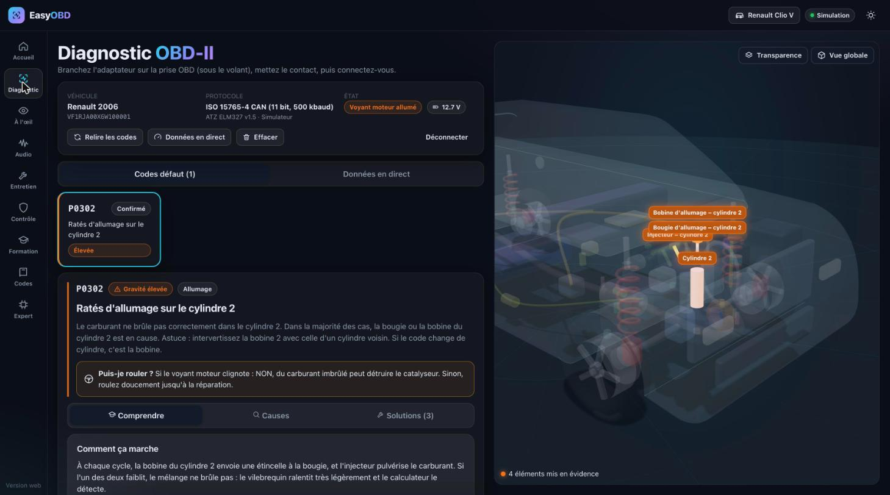
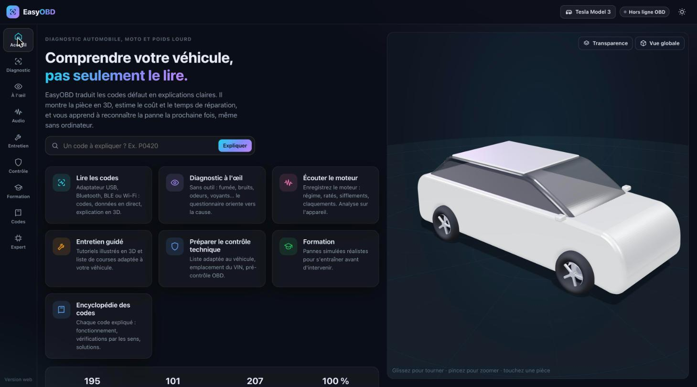
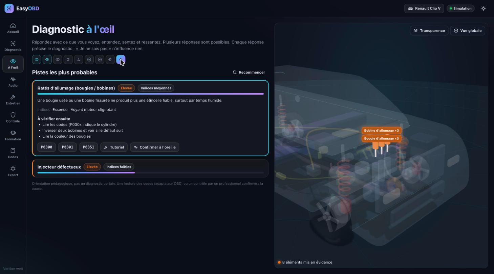
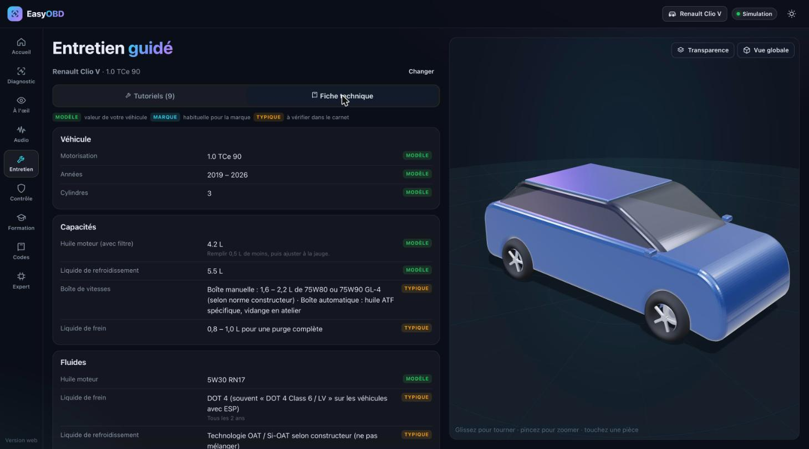
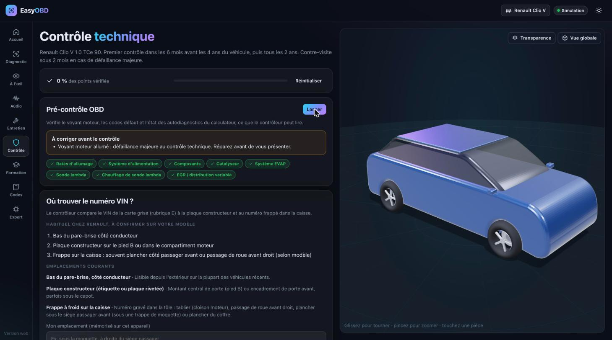
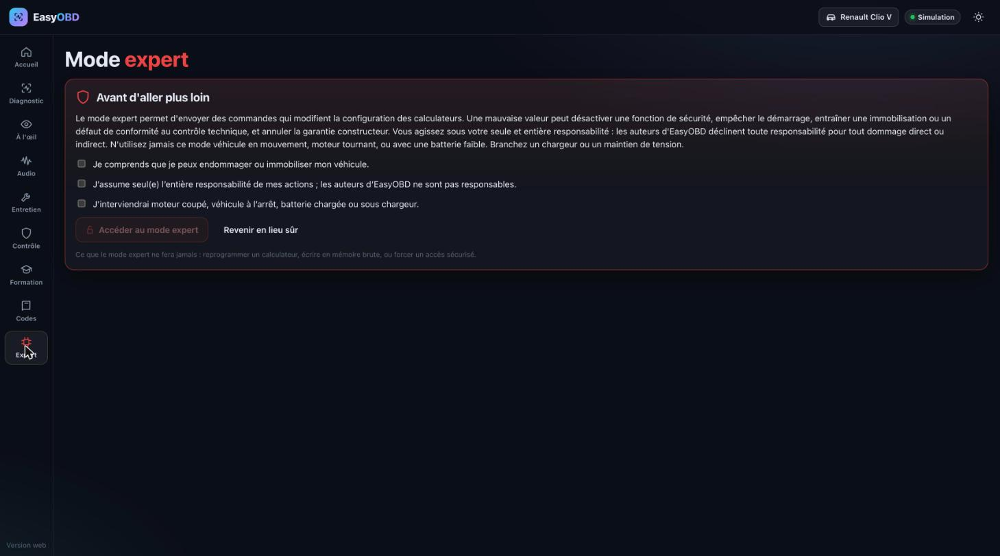

# EasyOBD

**Comprendre votre véhicule, pas seulement le lire.**

EasyOBD est une application de diagnostic automobile OBD-II, multi-plateformes et pédagogique. Elle traduit les codes
défaut en explications claires et montre la pièce concernée en 3D. Elle propose des solutions avec le coût des pièces,
des liens vers AutoDoc, Mister Auto et Oscaro, le temps nécessaire et le niveau de compétence requis. Elle apprend aussi
à reconnaître la panne la prochaine fois, sans ordinateur.

<p align="center">
  
</p>

> ⚠️ EasyOBD est un outil d'aide et de formation. Les prix, temps et probabilités sont **indicatifs**. En cas de doute,
> en particulier sur les freins, la direction, les airbags ou une alerte rouge, faites contrôler le véhicule par un
> professionnel.

## Fonctionnalités

| Module | Ce qu'il fait |
|---|---|
| **Diagnostic OBD-II** | Codes confirmés, en attente et permanents (services 03/07/0A), effacement (04), VIN, protocole, voyant moteur, tension batterie, données en direct (régime, températures, débit d'air, corrections de richesse…). |
| **Vue 3D** | Voiture, utilitaire, moto et poids lourd générés en 3D, avec le bon nombre de cylindres. Les pièces en cause sont mises en évidence avec la couleur de gravité. On peut toucher une pièce pour l'identifier ou l'isoler. |
| **Fiche de code** | « Comprendre » (fonctionnement), **vérifications par les sens** (vue, ouïe, odorat, toucher, ressenti) pour écarter les fausses pistes, causes classées par probabilité, solutions avec difficulté 1 à 5, temps, outils, étapes, pièces avec fourchette de prix et liens boutiques, coût « soi-même » ou « garage ». |
| **Diagnostic à l'œil** | Questionnaire sans outil (carburant, voyants, fumée, bruits, odeurs, comportement, circonstances, fluides) qui classe les hypothèses et renvoie vers les codes, la 3D et les tutoriels. |
| **Diagnostic audio** | Enregistrement en direct ou fichier audio. Analyse locale en Rust : régime estimé, indice de ratés, couinement de courroie ou de freins, sifflement de turbo, claquements, souffle. Les résultats alimentent le questionnaire. |
| **Entretien guidé** | Tutoriels pas à pas illustrés en 3D : vidange, filtres, bougies, plaquettes, niveaux, batterie, chaîne de moto, contrôles poids lourd. **Liste de courses** adaptée au profil du véhicule (quantités, norme d'huile, recherches incluant la marque et le modèle). |
| **Formation** | Scénarios de pannes réalistes joués sur le simulateur : plainte du client, lecture des codes et des données en direct, indices à découvrir, quiz, débriefing et score. |
| **Encyclopédie** | Recherche dans tous les codes documentés et explication générique de n'importe quel code (y compris constructeur). |
| **Mode expert** | Scan UDS (ISO 14229) de tous les calculateurs : identification, références, versions logicielles, défauts UDS. Console UDS. Écriture de paramètres (DID) avec garde-fous. |
| **Adaptateurs** | Détection **USB** (FTDI, CH340, CP210x, PL2303, OBDLink), **Bluetooth classique** (SPP), **Bluetooth LE** (Vgate, OBDLink CX, Veepeak, Konnwei…) et **Wi-Fi** (adresses usuelles). Débit série détecté automatiquement. Identification de la puce (ELM327, STN) et signalement des clones. |
| **Hors ligne** | Base de codes, tutoriels, profils, scénarios, 3D procédurale et analyse audio sont embarqués. Aucun serveur n'est nécessaire, seuls les liens boutiques demandent Internet. |

| Module | Ce qu'il fait |
|---|---|
| **Véhicules électriques** | Modèle 3D dédié (batterie de traction, moteur, onduleur, réducteur, chargeur, câbles orange), codes P0Axx, pistes propres aux électriques (batterie 12 V, isolement, recharge, réducteur, disques corrodés), tutoriels et scénarios dédiés, mode audio adapté. |
| **Fiche technique** | Capacités (huile, refroidissement, liquide de frein, boîte, AdBlue), fluides et **couples de serrage**, chaque valeur étant marquée *Modèle*, *Marque* ou *Typique*. |
| **Alternatives moins chères** | Huile de même norme en marque distributeur, 5W40 à la place de 5W30 seulement quand le moteur l'autorise (interdit sur les courroies baignées dans l'huile), équipementier d'origine plutôt que pièce siglée, DOT 4 ou 5.1 mais jamais DOT 5… |
| **Contrôle technique** | Liste de préparation filtrée selon le véhicule, emplacements du **VIN** par marque, pré-contrôle OBD (voyant, codes, autodiagnostics terminés). |
| **Procédures spécifiques** | Étapes issues du manuel du propriétaire, insérées dans les tutoriels (ex. Tesla : mise hors tension, mode Cric, batterie basse tension) avec leur source. |
| **Vidéos de réparation** | Recherche YouTube préremplie (intervention + véhicule), lecteur intégré (youtube-nocookie) pour une vidéo collée ou mise en favori, recherche dans l'app avec votre propre clé API. |
| **Catalogue** | Plus de 200 profils de voitures, utilitaires, motos et poids lourds (Kia, Hyundai, Tesla, BMW, Mercedes, Renault, Peugeot, Triumph, Ducati, KTM, Scania…), avec filtres par marque et par énergie. |

## Captures d'écran

| | |
|---|---|
|  **Accueil** : carrosserie peinte, reflets et ombres |  **Diagnostic** : la pièce en cause en 3D |
|  **Diagnostic à l'œil** : hypothèses classées |  **Fiche technique** : sources des valeurs |
|  **Contrôle technique** : pré-contrôle OBD et VIN |  **Mode expert** : garde-fous |

### Garde-fous du mode expert

La modification de paramètres peut immobiliser un véhicule. EasyOBD impose donc plusieurs protections :

- un avertissement explicite et trois engagements à cocher avant l'accès, puis la phrase **« J'ACCEPTE LES RISQUES »** à taper pour chaque écriture ;
- l'écriture est refusée si le moteur tourne ou si la batterie est sous 12,2 V ;
- la valeur d'origine est lue avant l'écriture, la nouvelle valeur est relue après, et chaque opération est **journalisée et restaurable** ;
- les services dangereux sont **bloqués** : reprogrammation (0x34–0x37), écriture mémoire (0x3D), automatisation de l'accès sécurisé (0x27) ;
- EasyOBD **ne fournit aucune recette d'écriture constructeur non vérifiée**. Les paramètres viennent de « packs » JSON importés par l'utilisateur, sous sa responsabilité ([exemple](docs/expert-pack.example.json), utilisable uniquement avec le simulateur).

Les auteurs d'EasyOBD déclinent toute responsabilité pour l'usage du mode expert.

## Architecture

```
EasyOBD/
├── crates/obd-core/   Cœur Rust (toute la logique, testée)
│   ├── elm327.rs      Session ELM327 : init, requêtes, ISO-TP multi-trames
│   ├── dtc.rs, pids.rs, vin.rs
│   ├── transport.rs   Wi-Fi/TCP, série (feature "serial")
│   ├── ble.rs         Bluetooth LE (feature "ble", btleplug)
│   ├── detect.rs      Découverte et identification des adaptateurs
│   ├── knowledge.rs   Base de connaissances, coûts, liens boutiques
│   ├── maintenance.rs Profils véhicules, tutoriels, listes de courses
│   ├── symptoms.rs    Questionnaire « à l'œil »
│   ├── audio.rs       Analyse audio (FFT, autocorrélation)
│   ├── training.rs    Scénarios de formation
│   ├── uds.rs         Mode expert ISO 14229
│   ├── simulator.rs   Véhicule + ELM327 virtuels (OBD et UDS)
│   └── api.rs         API JSON unique pour tous les frontaux
├── crates/obd-wasm/   Même cœur compilé en WebAssembly (version web)
├── src-tauri/         Application native Tauri 2 (desktop + mobile)
├── ui/                Interface Svelte 5 + Three.js
└── data/              Contenu en JSON (FR) : codes, entretien, symptômes, scénarios
```

**Pourquoi ce choix ?**

- Le **cœur en Rust** est fiable, rapide et portable. Il est compilé en natif pour l'application et en **WASM** pour le
  navigateur : la même logique tourne partout, et `api.rs` est le seul point d'entrée.
- **Tauri 2** produit des applications légères pour Windows, macOS, Linux, Android et iOS à partir d'une même base.
- **Svelte + Three.js** donnent une interface moderne et une 3D procédurale, sans aucun modèle à télécharger.

Le contenu (codes, tutoriels, scénarios) est en JSON dans `data/` : on peut l'enrichir sans toucher au code, et des
tests vérifient sa cohérence (composants 3D existants, prix, références croisées).

## Démarrer

Prérequis : Rust stable avec la cible `wasm32-unknown-unknown`, `wasm-bindgen-cli` 0.2.130, Node 20+. Sous Linux,
il faut aussi les [dépendances système de Tauri](https://tauri.app/start/prerequisites/), `libudev-dev` et `libdbus-1-dev`.

```sh
rustup target add wasm32-unknown-unknown
cargo install wasm-bindgen-cli --version 0.2.130
npm install && npm install --prefix ui

npm run dev:web      # version web (simulateur) sur http://localhost:5173
npm run dev          # application native (adaptateurs réels)
npm run build        # paquets d'installation desktop
sh scripts/check.sh  # vérification complète (tests Rust, WASM, types, build)
```

### Mobile (Android / iOS)

```sh
npx tauri android init && npx tauri android dev   # Android Studio + SDK/NDK requis
npx tauri ios init && npx tauri ios dev           # macOS + Xcode requis
```

Sur mobile, les adaptateurs **Wi-Fi** fonctionnent dès maintenant. Le Bluetooth LE est actif sur desktop. Son
activation sur Android et iOS figure dans la feuille de route : `btleplug` demande une initialisation JNI spécifique sur
Android.

## Adaptateurs testés et conseillés

- **Bluetooth LE** (iPhone, Android, ordinateurs) : Vgate iCar Pro BLE, OBDLink CX, Veepeak OBDCheck BLE.
- **Wi-Fi** : la plupart des dongles ELM327 Wi-Fi (`192.168.0.10:35000`).
- **USB** : OBDLink SX/EX, câbles ELM327 à puce FTDI.
- Les clones « ELM327 v2.1 » lisent généralement les codes, mais certains véhicules anciens ou multi-calculateurs posent problème.

## Données et limites

- Les **prix** sont des fourchettes indicatives de pièces adaptables (France, 2026). La main-d'œuvre garage est estimée à 75 €/h (réglable dans `data/knowledge_base.fr.json`).
- **Liens boutiques** : la recherche AutoDoc pointe directement sur le site. Pour Mister Auto et Oscaro, les liens passent par une recherche Google limitée au site. Ces modèles d'URL sont configurables dans `providers`. Aucun partenariat ni API de prix temps réel n'est intégré pour l'instant.
- Les **profils véhicules** (contenances, normes d'huile) sont des valeurs de départ à vérifier dans le carnet d'entretien. La saisie manuelle couvre tous les autres véhicules.
- **Poids lourds** : les codes moteur OBD sur CAN sont lus. Le protocole J1939 (codes SPN/FMI) est dans la feuille de route.
- **Analyse audio** : elle est heuristique et oriente, sans jamais remplacer un contrôle.
- **Vidéos** : YouTube n'autorise plus l'intégration d'une page de résultats de recherche. La recherche s'ouvre donc sur YouTube, sauf si une clé API est fournie. Dans l'application de bureau, certaines vidéos peuvent refuser la lecture intégrée : le bouton « ouvrir dans YouTube » sert alors de repli.

## Modèle économique

Pistes détaillées dans [docs/MODELE_ECONOMIQUE.md](docs/MODELE_ECONOMIQUE.md) :

- freemium (« EasyOBD+ ») ;
- affiliation transparente ;
- adaptateur à la marque EasyOBD ;
- mise en relation avec des garages ;
- certificat batterie pour les véhicules électriques ;
- offres de formation et pour les flottes.

## Feuille de route

- Bluetooth LE sur Android et iOS ; Web Serial et Web Bluetooth pour la version navigateur.
- J1939 (poids lourds) et adressage CAN 29 bits pour le mode expert.
- Packs de données téléchargeables par véhicule (base de codes constructeur, profils), mis en cache pour un usage hors ligne.
- Partenariats ou API marchands pour des prix en temps réel.
- Historique des diagnostics par véhicule, export PDF du rapport.
- Traduction anglaise : le format des données le permet déjà, avec un fichier par langue.

## Licence

MIT. Voir [LICENSE](LICENSE).
